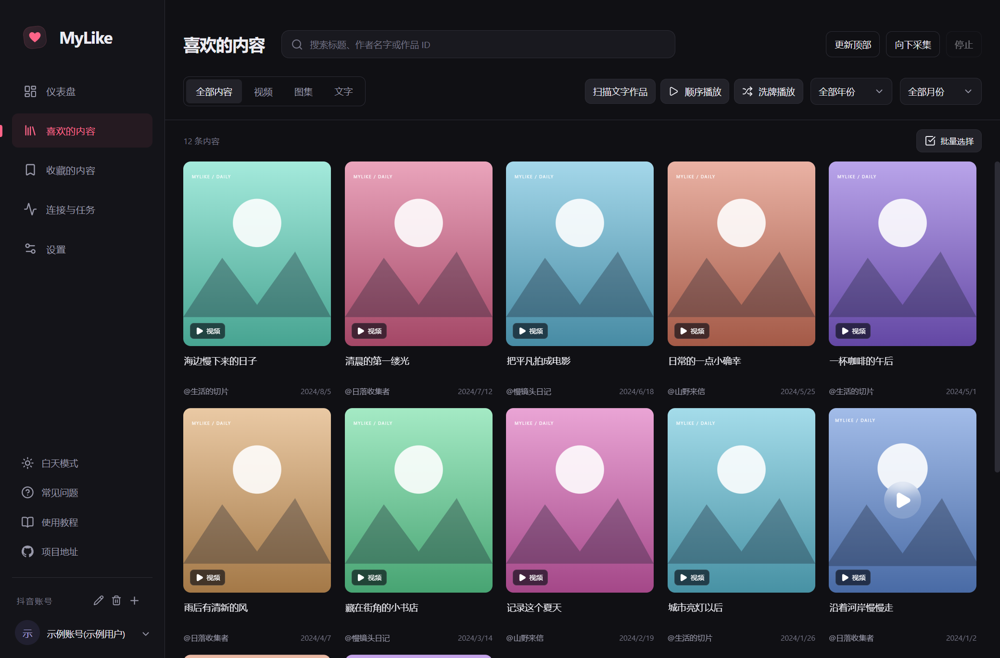
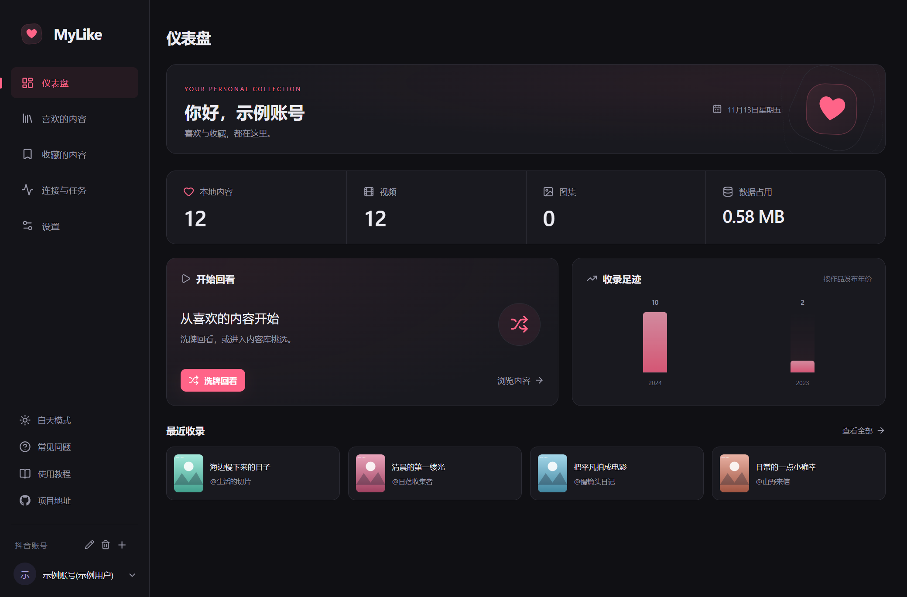
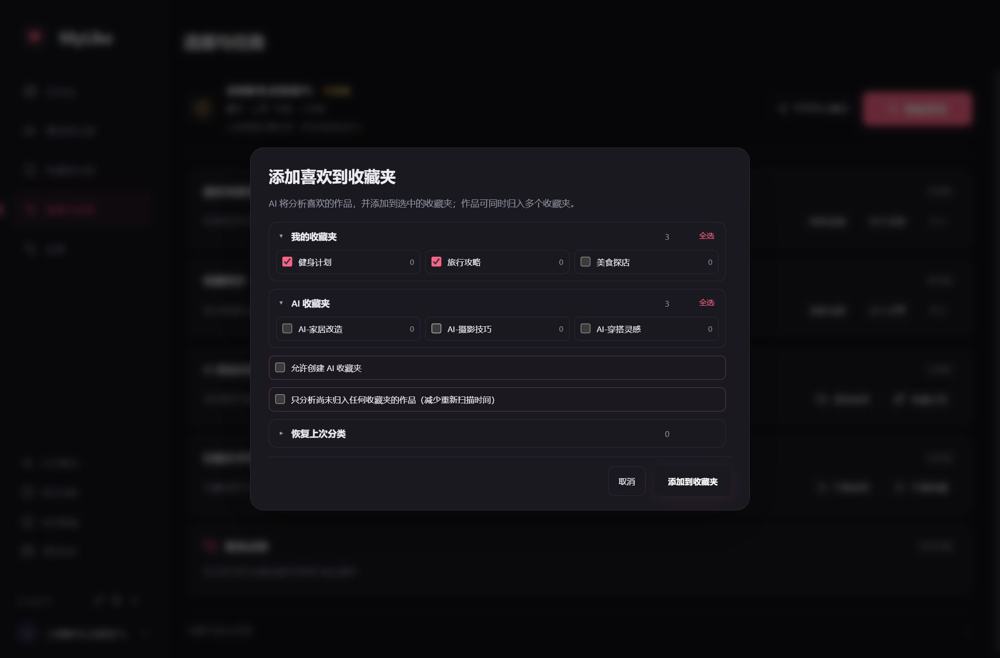
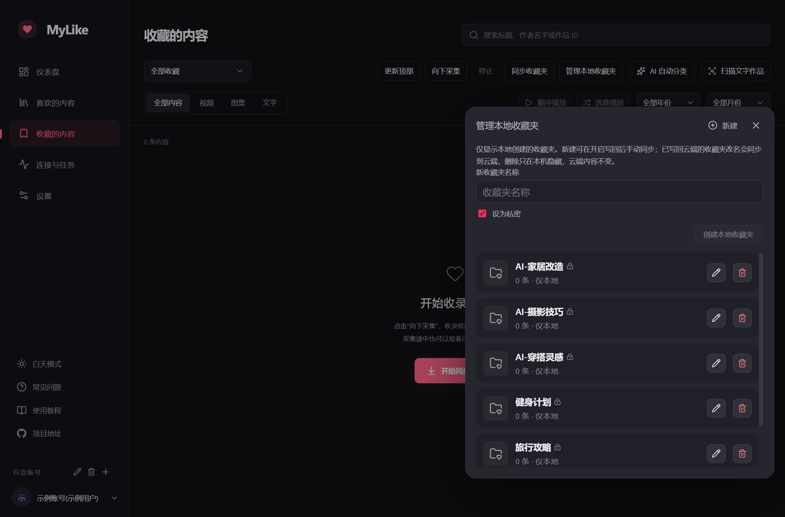
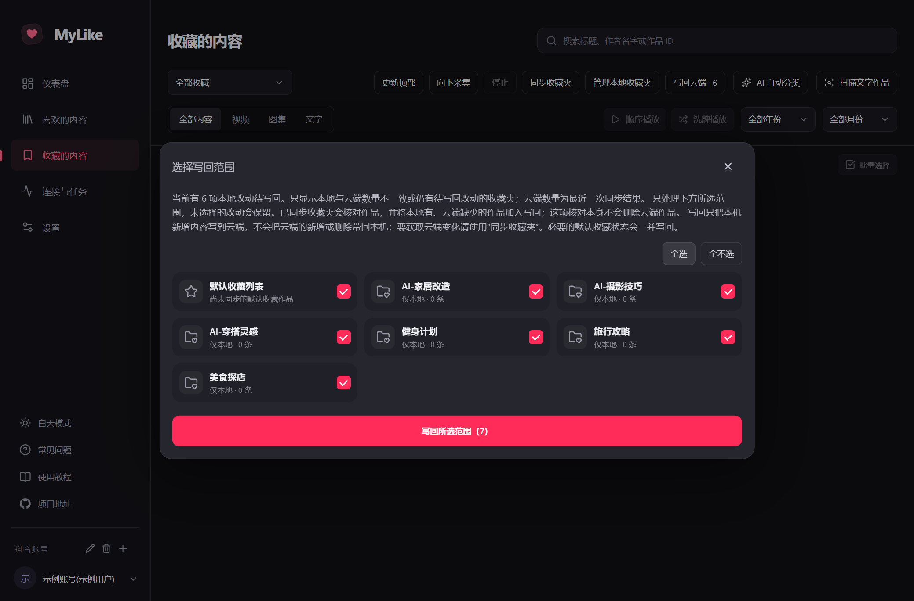

<div align="center">


# MyLike

**把喜欢，再喜欢一遍。**

一个回看抖音喜欢与收藏的 Windows 桌面应用。

上游原版的收藏夹与云端保持一致；本仓库新增了只保存在本机的收藏夹，可按需写回抖音，并提供 AI 自动分类。

[](https://github.com/hqing8156-prog/douyin-favorite-MyLike/releases/latest)
[](https://github.com/hqing8156-prog/douyin-favorite-MyLike/releases/latest)
[](https://github.com/hqing8156-prog/douyin-favorite-MyLike/actions/workflows/desktop.yml)
[](LICENSE)

[](https://github.com/hqing8156-prog/douyin-favorite-MyLike/stargazers)
[](https://github.com/hqing8156-prog/douyin-favorite-MyLike/forks)
[](https://github.com/hqing8156-prog/douyin-favorite-MyLike/releases)

[下载应用](https://github.com/hqing8156-prog/douyin-favorite-MyLike/releases/latest) · [功能特性](#功能特性) · [界面预览](#界面预览) · [反馈问题](https://github.com/hqing8156-prog/douyin-favorite-MyLike/issues)

</div>

## 界面预览

> 截图为示例数据，不包含真实账号、作品或收藏夹信息。

### 喜欢的内容



### 仪表盘



### AI 自动分类



### 本地收藏夹管理



### 写回云端



## 下载

**[下载最新版 · Windows x64](https://github.com/hqing8156-prog/douyin-favorite-MyLike/releases/latest)**

在发布页下载文件名以 `portable.exe` 结尾的应用，保存到固定文件夹后双击运行，免安装使用。

本仓库仅提供 Windows x64 版本，是持续维护的分支；下载、更新与问题反馈请以本仓库的发布页和 Issues 为准。

v2.0.5 与 v2.0.4 的本地数据兼容。升级前请退出旧版，再使用新版 EXE；旧 WPF 版的数据与登录态不迁移，首次使用新版需重新登录和采集。

## 功能特性

- **喜欢与收藏**：增量采集、断点续采、单独同步收藏夹内容与按夹浏览；AI 分类前实时核实收藏夹列表；播放中收藏、多选加入收藏夹及新建收藏夹。
- **AI 整理**：可将喜欢作品添加到选中的收藏夹，或将已收藏作品分类到收藏夹；分类前核实远端收藏夹，只有明确勾选并填写逗号分隔的名称后才会创建私密 AI 收藏夹，同名收藏夹会复用；同一作品可归入多个收藏夹。
- **同步整理**：单条或批量取消抖音点赞、收藏，平台确认后同步更新本地记录。
- **随手找到**：标题 / 作者搜索，类型与年月筛选，触底自动加载，长列表流畅浏览。
- **沉浸回看**：顺序 / 洗牌、断点续播、视频 / 图集 / 实况原声混音、播放器内评论与回复、倍速、全屏、清屏、播放列表与自定义快捷键。
- **边采边看**：后台采集或取消点赞、收藏时继续播放，任务进度和异常集中管理，统一核验登录、喜欢与收藏状态。
- **本地管理**：多账号隔离、账号改名与删除、批量整理与关键操作自动备份。
- **按你的习惯**：深浅主题、界面缩放、窗口记忆、播放偏好与内容仪表盘。

## 相比上游的改动

本仓库是上游项目的延续分支，版本号独立维护。上游原版把收藏夹与云端保持一致；本仓库在此基础上增加了只保存在本机的收藏夹，并按需写回。主要改动如下：

| 能力 | 说明 |
| --- | --- |
| **AI 自动分类** | 接入 DeepSeek / 硅基流动，结合作品文案与语音转文字自动归类；分类前实时核实远端收藏夹，同名收藏夹复用，同一作品可归入多个收藏夹 |
| **仅保存在本机的收藏夹** | 上游原版的收藏夹与云端一致；本仓库可新建只存在于本机的收藏夹，默认不写回云端，不影响抖音上的收藏夹 |
| **按需写回抖音** | 需要时在收藏页选择范围写回；弹窗只列出数量不一致或仍有待写回改动的收藏夹，只处理所选范围，核对并补写云端缺少的作品，不可见作品跳过并在结果中统计；可点开单个收藏夹只读核对本地与云端的差异（本地有、云端无 = 将补写；云端有、本地无 = 不会删除） |
| **本地收藏夹管理** | 新建、改名、删除本地创建的收藏夹；改名只影响本机，删除已写回的夹只在本机隐藏，不会删除云端收藏夹 |
| **作者名快捷操作** | 播放页左键作者名打开主页，右键复制作者名称 |
| **封面本地缓存** | 收藏夹与差异核对中的封面按需下载到本机，避免云端地址失效后裂图；缓存目录可在“设置 → 数据与存储”自定义 |
| **诊断日志** | 分类、收藏与同步的请求和结果写入日志文件，便于定位问题 |

播放器内嵌评论与回复、喜欢与收藏采集等能力与上游保持一致。

## 更新日志

### v2.0.5（本仓库）

- **安装包更新**：本次发布基于当前分支最新代码重新构建，正式包含下列 v2.0.4 更新内容
- **文档修正**：更新本仓库界面截图，修正本地收藏夹与云端同步的说明
- **数据兼容**：本地数据与 v2.0.4 兼容，可直接替换旧版 EXE

### v2.0.4（本仓库）

- **AI 自动分类**：新增“添加喜欢”和“收藏分类”两个入口，分别从喜欢列表、收藏列表取作品；按作品内容与收藏夹名称匹配，避免所有作品被写入同一个收藏夹；AI 返回格式异常时自动拆分批次重试；进度未覆盖全部作品时不标记完成，失败原因保留在“连接与任务”
- **收藏夹移除**：可从指定收藏夹批量移出作品，默认收藏中的收藏状态保持不变；确认后立即关窗并跳转“连接与任务”，显示进度且可随时停止
- **本地收藏夹（默认不同步）**：上游原版收藏夹与云端一致；本仓库新建的收藏夹默认只保存在本机。设置中提供“允许同步本地收藏夹到抖音”开关（默认关闭），开启后可手动写回
- **写回云端**：弹窗只列出本地与云端数量不一致或仍有待写回改动的收藏夹，支持全选，只处理所选范围；写回时核对作品并补写云端缺少的内容，不可见作品跳过并在结果中统计
- **本地收藏夹管理**：支持新建、改名、删除；改名只影响本机，删除已写回的收藏夹只在本机隐藏，云端收藏夹与夹内作品保留
- **作者名交互**：列表卡片和播放页左键作者名打开抖音主页，右键复制昵称；解析并保存作者标识，旧作品缺少标识时按需补取
- **收藏夹识别**：按云端 ID 判断本地与云端是否为同一收藏夹，避免改名、同名导致的错配
- **测试**：新增 AI 分类与共享协议单元测试，单元测试共 292 项

### 来自上游的基线

喜欢与收藏采集、断点续采、按夹浏览、取消点赞 / 收藏、搜索筛选、播放器（顺序 / 洗牌、倍速、全屏、清屏、播放列表、自定义快捷键）、多账号隔离等功能沿用上游实现。

## 快速上手

1. **添加账号并登录**：在应用打开的抖音窗口中完成扫码登录，身份核验成功后窗口自动收起。
2. **收录内容**：喜欢与收藏统一使用“更新顶部、向下采集、停止”：获取新内容、继续历史采集或保存进度停止；收藏页还可单独“同步收藏夹”及其中的作品，按夹浏览。默认关闭“允许同步本地收藏夹到抖音”：播放页的收藏、新建收藏夹和 AI 分类结果都只记录在本机，不修改抖音。开启后，播放页收藏会按平台确认同步到云端；从收藏页点击“写回云端”可把尚未同步的本机改动（默认收藏、AI 分类结果、新建收藏夹及夹内作品）写到抖音，弹窗只列出本地与云端数量不一致或仍有待写回改动的本地收藏夹，可选择默认收藏列表和要写回的收藏夹（支持全选）。只处理所选范围，其他改动保留；写回已同步收藏夹时会核对作品，并补写本地存在、云端缺少的内容，核对本身不会删除云端作品，遇到不可见作品会跳过并在结果中统计；点收藏夹右侧的“差异”可只读核对具体作品（本地有、云端无 = 将补写；云端有、本地无 = 不会删除）。可用“同步收藏夹”重新拉取云端收藏夹内容。可在“管理本地收藏夹”中新建、改名或删除本地创建的收藏夹；改名仅影响本地，删除已写回的夹会在本机隐藏而不会删除云端收藏夹，夹内作品仍保留在默认收藏列表。AI 分类前会先核实抖音收藏夹列表。
3. **开始回看**：直接点播，或在筛选范围内顺序 / 洗牌播放。清屏时按 Esc 或清屏快捷键退出，默认 H，可在设置修改。

任务受阻时，到“连接与任务”点击“核验状态”，查看绿色正常、黄色不明确或红色异常及对应建议。需要登录或验证时会打开抖音窗口，完成后自动收起；核验不会自动恢复已停止的任务。更多操作见应用内的「使用教程」与「常见问题」。

本地数据保存在 `%APPDATA%\MyLikeElectron`。本地删除与远端取消点赞、收藏是不同操作，远端取消前会要求确认；取消收藏会移除全部收藏夹关联，喜欢记录保留。

## 开发

使用 Electron + TypeScript + React + SQLite。需要 Node.js 24.12+、pnpm 11.22。

```powershell
cd apps/desktop
pnpm install --frozen-lockfile
pnpm dev
```

`pnpm test` 运行单元测试，`pnpm test:e2e` 运行桌面集成测试，`pnpm package:win` 生成 Windows 发行包。旧版源码、测试和构建流程统一保存在 [`legacy/`](legacy/)。

## 免责声明

- 本项目用于个人学习与账号内容整理，与抖音 / 字节跳动无关联，未经其授权或背书。
- 请仅访问和整理本人账号或已获授权的数据，遵守适用法律法规、平台服务条款及内容权利人的合法权益。请勿用于未经授权的采集、侵权传播或其他滥用行为。
- 视频、图片、音乐等内容的权利归原权利人所有；本地收录不代表获得转载、传播或其他使用授权。
- 平台接口、访问限制或内容状态变化可能导致功能不可用、采集不完整。请自行备份重要数据，并在批量取消点赞等操作前确认账号和范围。
- 软件按现状提供，不保证持续可用或适用于特定用途。在适用法律允许的范围内，作者不承担因使用本软件产生的账号限制、数据丢失等损失责任；具体以 [MIT License](LICENSE) 的担保与责任条款为准。

## 许可证

本项目采用 [MIT License](LICENSE)，第三方组件保留各自的版权和许可证，相关声明随发行包提供。
